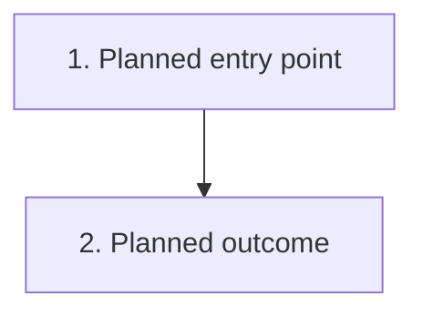

# Design the smallest worthwhile change

Turn the agreed brief into an implementable plan. Reference the purpose and criteria rather than repeating them. Do not implement.

## Understand the starting point

Use the change's directory, normally `docs/<ticket-number>/` or an agreed kebab-case name. Read `brief.md`, `acceptance.md`, any existing design and relevant repository ADRs, then inspect the affected code and tests. Record the baseline revision.

If the brief or criteria are missing, suggest `understand` or agree on them with the user first. Surface conflicts, infeasible requirements and decisions needing approval rather than inventing requirements or silently changing scope. Preserve unrelated content when revising an existing plan.

## Define observable scenarios

Add scenarios only to `acceptance.md`, under each S, AC and X criterion, using IDs such as AC1.1. Use D1.1 for scenarios introduced by a design decision. Cover the intended outcome, relevant failures and boundaries, and behavior that must stay unchanged; for a spike, define what must be learned.

Each row must have one independently judgeable outcome and a feasible check. Fill only **Scenario → expected**, **Check** (a category from the legend) and **Gap**. Mark assumptions or partial coverage with ⚠ for the user's decision. When revising an expectation, clear its stale stage results.

## Write `design.md`

Use this format. Keep sections short and proportional to the change; omit **Open questions** when none remain. Use real code names and paths, marking new ones as planned.

Choose diagrams by what the design changes:

- **Code changes (other than UI-only design):** always include a class diagram of the affected types or modules and their relationships, plus at least one sequence diagram or flowchart showing the changed behavior.
- **UI-only design:** these diagrams are optional; include them only when they clarify the design.
- **Database changes:** add an ER diagram when it clarifies affected entities, relationships or constraints.

Use sequence diagrams for interactions over time, flowcharts for branches and journeys, and class diagrams for structure. Include both sequence and flowchart views only when each explains something different. Keep diagrams focused on the affected area; do not invent classes or database entities just to fill a diagram.

````markdown
# <Change title>

[Brief](brief.md) · [Acceptance](acceptance.md)
Baseline: <revision>

## Approach
<How the smallest change delivers the agreed outcome; name the affected components and boundaries.>

## Flow
<Summarize current behavior; link or draw a Before diagram when useful.>



<Replace the example with a sequence diagram or flowchart of planned behavior. Number its steps and link them to scenario or decision IDs. For UI-only design, a plain-language description is enough unless a diagram adds value.>

## Structure
<Required for non-UI-only code changes: a Mermaid class diagram of affected types or modules and relationships. Add an ER diagram when it clarifies database changes. Omit this section for UI-only design unless useful.>

## Decisions
- **D1:** <Choice and why. Alternative rejected and trade-off. Link an ADR if needed.>

## Rollout
- **R1:** <Relevant flags and defaults, deployment or migration order, rollback and production checks. Say “No special rollout” when none apply.>

## Open questions
<Unresolved decisions and assumptions, their impact, and whose input is needed.>
````

Record only consequential decisions. Create an ADR for a hard-to-reverse choice or a rule that outlives this change; otherwise keep it here. Follow the repository's ADR format and location, defaulting to `docs/adr/NNNN-<slug>.md` with context, decision, alternatives and consequences. New ADRs stay Proposed until approved; supersede accepted ADRs rather than rewriting their decisions.

## Hand off

Report paths written, unresolved decisions and gaps against the brief. Render and inspect diagrams when a renderer is available; otherwise say they were not checked. A plan is not evidence that checks passed. Use `implement` when the user asks to build it.
